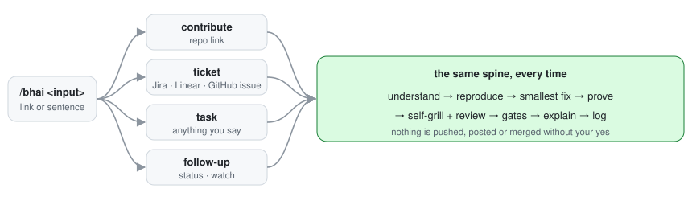

<p align="center">
  <picture>
    <source media="(prefers-color-scheme: dark)" srcset="assets/logo-dark.svg">
    
  </picture>
</p>

<h3 align="center">Paste a repo, a ticket, or a sentence.<br>It reproduces the bug, makes the smallest fix, proves it, and tells you how to defend it.</h3>

<p align="center"><em>Bhai, bas bol de.</em></p>

<p align="center">
  
  
  
  
</p>

<p align="center">
  
  <br><sub>Illustration built from a real merged fix, <a href="https://github.com/KoljaB/RealtimeSTT/pull/332">RealtimeSTT #332</a>, with that repo's measured numbers.</sub>
</p>

<p align="center">
  <a href="#install">Install</a> · <a href="#one-command-four-jobs">What it does</a> · <a href="#why-it-doesnt-break-things">Safety</a> · <a href="#faq">FAQ</a>
</p>

---

## Install

```bash
claude plugin marketplace add ANDROIDHASSAN/bhai
claude plugin install bhai@bhai
```

Then, in any repo: `/bhai <a link or a sentence>`.

## One command, four jobs

| You type | bhai does |
|---|---|
| `/bhai https://github.com/owner/repo` | learns how that repo merges, finds a real bug, reproduces it with a failing test, fixes it, drafts a PR in the repo's own style |
| `/bhai ABC-123` · a Jira/Linear/GitHub issue link | reads the whole ticket (comments, screenshots, logs if connected), finds the root cause and its siblings, fixes and proves it |
| `/bhai add retry with backoff to the uploader` | just does it, the same careful way |
| `/bhai status` · `/bhai watch owner/repo` | looks after your open PRs: red CI, conflicts, bot reviews, merges, then the next bug |

<p align="center"></p>

## The best fix is the shortest correct one

| Most AI fixes | bhai |
|---|---|
| patch the line the error points at | fixes the root cause where every caller routes through, and the sibling bugs with the same cause |
| add a new helper | reuses what the codebase already has; one line if one line works |
| "tests pass" | the test **fails on the old code first**, then a mutation check breaks the fix to make sure the test notices |
| big diff | a shrink pass deletes every line the tests and acceptance list don't need |
| guesses | reads the real log line and database record when you have them connected (read-only) |
| "should work" | 29 self-grill questions before and after the fix, answered from command output |

## Why it doesn't break things

| It always | It never, without your yes |
|---|---|
| reproduces before it fixes | pushes, opens a PR, comments, merges or deploys |
| runs the repo's own lint, type and test commands, and its CI workflows locally | force-pushes, adds a dependency, or edits lockfiles and versions |
| merges the default branch right before opening a PR, so there are no conflicts | claims a number it didn't measure |
| follows each repo's AI-contribution policy, and stops where it forbids AI PRs | opens more than 2 PRs in one repo |
| keeps the diff to the fix and its test | puts itself in your commits or PRs |

`--auto` is a one-run yes for a single PR whose gates all passed. Human reviewers, CLAs and design questions still come to you.

## It explains like a friend

```text
fix/client-empty-language — draft ready, PR nahi khola
Bug kya tha: client language="" bhejta hi nahi tha, server "en" pe atak jaata tha
Fix kya kiya: client ab --language "" pass karta hai; server ka default chhua nahi
Proof: naya test master pe fail hua, fix ke baad pass; repo ke tests green
Reviewer pooche to: "server default badalna breaking change hota, isliye client side fix kiya"
Tumhe karna hai: "haan" bolo to PR khol dun
```

Hinglish by default, technical words in English. Write to it in another language and it answers in that one.

## Where it comes from

The workflow inside `/bhai` is the one behind **[16 merged pull requests](https://github.com/pulls?q=is%3Apr+author%3AANDROIDHASSAN+is%3Amerged+-user%3AANDROIDHASSAN)** in LiveKit, RealtimeSTT,
RealtimeTTS, Piper and Mastra in October 2026, plus a production ticket flow for a voice-AI platform. Each rule exists because of
a real failure; the research behind them is in [`research.md`](skills/bhai/references/research.md).

## Every run is logged

One Markdown file per run in `~/.bhai/runs/`: decisions, every command and its output, the diff, each gate.
It lives outside your repo, so it can never land in a commit.

## FAQ

**Will my PR get merged?** No tool can promise that; maintainers decide. bhai removes everything on your side that
blocks a merge: conflicts, red CI, style mismatches, missing template sections, duplicates.

**Is this an AI-PR spam machine?** The opposite. It refuses repos that ban AI PRs, caps you at 2 open PRs per repo,
never pings maintainers, and won't open a PR you can't explain. Read the [gates](skills/bhai/references/gates.md).

**What does it need from me?** A link or a sentence, `gh` logged in, and a "haan" before anything leaves your machine.
[Full list](skills/bhai/references/user-contract.md).

**Does it work with Codex, Cursor or Gemini CLI?** The skill uses the open Agent Skills format. It is tested on Claude Code;
other agents are not verified yet.

**What doesn't it do?** Model-quality bugs (LLM/STT/TTS behaviour), product decisions, and anything it can't reproduce:
it stops and tells you why.

## License

MIT © Hassan Kazi
